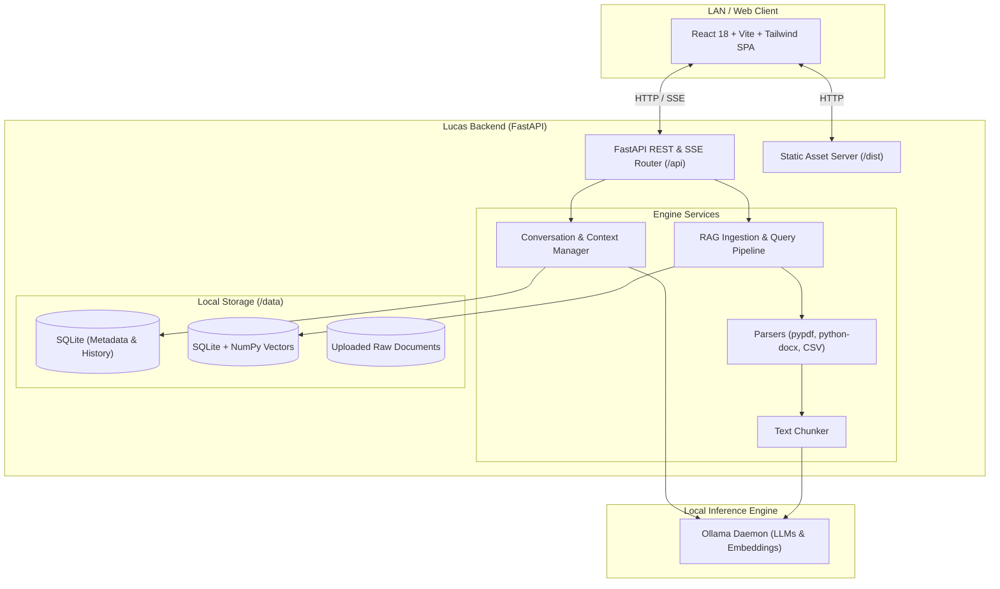

# 🧠 LUCAS

<p align="center">
  <strong>Your intelligence. Your infrastructure.</strong><br>
  A lightweight, fully private, self-hosted AI chatbot and document intelligence (RAG) platform tailored for local edge devices like Raspberry Pi 5, Apple Silicon Macs, and Linux home servers.
</p>

<p align="center">
  
  
  
  
  
  
  
</p>

---

## ⚡ Overview

**LUCAS** is an end-to-end local artificial intelligence suite that operates completely within your own network without reliance on external cloud APIs or monthly subscription fees. Powered by **Ollama**, LUCAS enables real-time token streaming, multi-turn conversational memory, and retrieval-augmented generation (RAG) across your private documents.

Built with resource efficiency in mind, LUCAS runs seamlessly on low-footprint single-board computers (such as the **Raspberry Pi 5 8GB/4GB**), standard laptops, or home homelab servers, serving a modern, responsive web application across your entire local area network (LAN).

---

## ✨ Key Features

- **🔒 100% Offline & Private:** Zero third-party telemetry, no cloud dependencies. Conversations, vector embeddings, and documents never leave your local hardware.
- **⚡ Real-time SSE Streaming:** Token-by-token low-latency response rendering using Server-Sent Events (SSE).
- **📚 Retrieval-Augmented Generation (RAG):**
  - Instant document indexing and semantic search.
  - Multi-format ingestion support: **PDF, DOCX, TXT, Markdown, CSV, and JSON**.
  - Sentence & structure-aware chunking with sliding overlap.
  - Source citations directly embedded into chat responses with preview modal capabilities.
- **🪶 Ultra-Lightweight Embedded Vector Engine:**
  - Custom SQLite + NumPy vector engine optimized for edge hardware (no heavy vector databases or excessive background memory consumption).
  - Cosine similarity matching with dynamic similarity threshold filtering and context budgeting.
- **🌐 Network-Wide Access:** Bind to `0.0.0.0` to chat from any phone, tablet, or laptop on your local Wi-Fi or wireguard network, with optional pre-shared token authentication (`LAN_AUTH_TOKEN`).
- **🎛️ Real-Time Settings & System Monitor:**
  - View live CPU and memory telemetry.
  - Test and switch Ollama models on the fly.
  - Tune RAG chunk sizes, top-k retrieval, and temperature without restarting the service.
- **🐳 Multi-Architecture Deployment:** First-class support for `systemd` background services, Docker, Docker Compose, and native Makefile routines.

---

## 🏗️ Architecture



---

## 🚀 Quick Start

### Prerequisites

1. **Python 3.10+** (Python 3.11 recommended)
2. **Node.js 18+** & `npm`
3. **[Ollama](https://ollama.ai/)** installed and running:
   ```bash
   # Pull your preferred chat model and embedding model
   ollama pull llama3.2:3b
   ollama pull nomic-embed-text
   ```

### 1. Clone & Setup

```bash
git clone https://github.com/Rushiiii505/LUCAS.git
cd LUCAS

# Run automated environment setup
make install
```

The setup script creates a virtual environment, installs backend requirements, builds the production frontend bundle, and provisions the default `.env` file.

### 2. Configuration (`.env`)

Verify your environment configuration in `.env`:

```env
APP_NAME=Lucas
ENVIRONMENT=production
HOST=0.0.0.0
PORT=8000

# Ollama Endpoint
OLLAMA_BASE_URL=http://127.0.0.1:11434
DEFAULT_MODEL=llama3.2:3b
DEFAULT_EMBEDDING_MODEL=nomic-embed-text

# Low memory optimization (Ideal for Pi 5 & edge devices)
LOW_MEMORY_MODE=true
MAX_SIMULTANEOUS_GENERATIONS=1
```

### 3. Launch Lucas

```bash
# Start Lucas production server on port 8000
make start
```

Access the web interface at **`http://localhost:8000`** or from any device on your local network using your host's IP address (e.g., `http://192.168.1.150:8000`).

---

## 💻 Development Workflow

If you want to contribute or develop features:

```bash
# Start backend (auto-reload on port 8000) and frontend (Vite HMR on port 5173)
make dev
```

Run test suites:
```bash
make test
```

Build production frontend:
```bash
make build
```

---

## 📂 Project Structure

```
LUCAS/
├── backend/
│   ├── app/
│   │   ├── api/            # FastAPI route handlers (chat, documents, health, models, settings)
│   │   ├── database/       # SQLite database schema, connections, and repositories
│   │   ├── services/       # Ollama integration, chunking, parsers, RAG, and vector engine
│   │   ├── utils/          # Logging, hardware telemetry, and helpers
│   │   ├── config.py       # Pydantic BaseSettings configuration
│   │   └── main.py         # App factory, static asset mounting, and lifespan management
│   ├── tests/              # Pytest automated test suite
│   └── requirements.txt    # Python dependencies
├── frontend/
│   ├── src/
│   │   ├── components/     # UI components (ChatComposer, Sidebar, KnowledgeBase, SettingsDialog)
│   │   ├── hooks/          # React hooks for state and streaming
│   │   ├── services/       # API clients for backend endpoints
│   │   ├── types/          # TypeScript interface definitions
│   │   ├── App.tsx         # Main application container
│   │   └── index.css       # Tailwind CSS base & utilities
│   ├── package.json        # Frontend dependencies & build scripts
│   └── vite.config.ts      # Vite configuration & proxy rules
├── deploy/
│   ├── Dockerfile          # Multi-stage production container image
│   ├── docker-compose.yml  # Compose configuration for container deployment
│   └── lucas.service       # systemd unit file for Linux / Raspberry Pi
├── scripts/
│   ├── setup.sh            # Automated installation and dependency setup
│   └── run.sh              # Production startup script
├── data/                   # Persistent local storage (SQLite, vectors, uploads)
├── Makefile                # Unified build, test, and run commands
└── README.md
```

---

## 🍓 Raspberry Pi 5 & Linux Service (`systemd`)

To keep Lucas running continuously as a system background service on your Raspberry Pi:

```bash
# 1. Copy the systemd service template
sudo cp deploy/lucas.service /etc/systemd/system/lucas.service

# 2. Adjust paths and user in the service file if necessary
sudo nano /etc/systemd/system/lucas.service

# 3. Reload systemd and enable service
sudo systemctl daemon-reload
sudo systemctl enable --now lucas.service

# 4. Check status
sudo systemctl status lucas.service
```

---

## 🐳 Docker Deployment

Run Lucas via Docker Compose:

```bash
cd deploy
docker compose up -d
```

The containerized service will bind to port `8000` and communicate with your host's Ollama instance.

---

## 🛡️ License

This project is open-source and available under the [MIT License](LICENSE).
